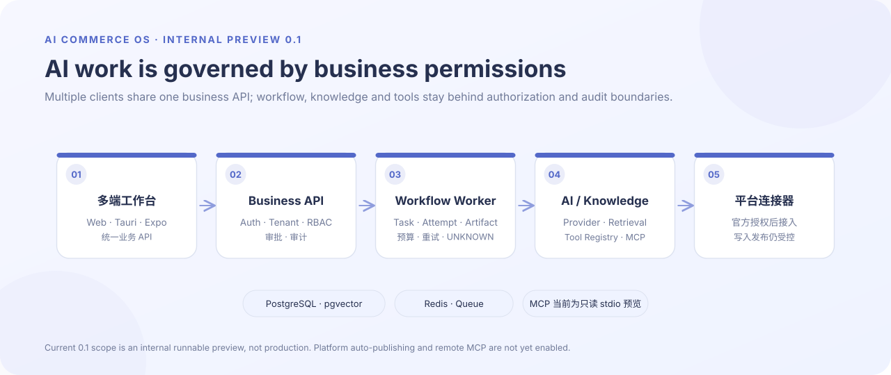

# AI Commerce OS

开放式 AI 电商操作系统，面向多店铺、多平台电商团队，将 AI 员工、工作流、知识、工具和平台连接器组合成可审计的工作台。

**当前阶段：0.1 内部可运行预览，正在验收；尚未生产上线。** 从 [PROJECT_PLAN.md](PROJECT_PLAN.md) 阅读定位；设计入口依次为 [UI/UX](docs/UI_UX_DESIGN.md)、[技术栈](docs/TECH_STACK.md)、[架构](docs/ARCHITECTURE.md)、[数据模型](docs/DATA_MODEL.md)、[目录](docs/PROJECT_STRUCTURE.md)、[任务](docs/TASKS.md)。决策记录在 [docs/adr](docs/adr)。

## 架构总览

<p align="center">
  
</p>
<p align="center">
  
</p>

<sub>图示依据当前架构与 0.1 实施范围整理。当前版本是内部可运行预览：MCP 为只读 stdio 预览，远程 MCP 与真实平台自动发布尚未启用；这不是生产部署拓扑。</sub>

## 项目边界

- 一个可配置的 LLM Provider Layer 支撑多岗位工作流；岗位通过权限、工具、知识域和操作策略区别，不创建互不兼容的“员工大脑”。
- 优先服务商品运营、客服、市场分析，发布商品作为受控动作。拼多多、淘宝/天猫、京东等平台仅在官方授权、接口资格、沙箱和审核规则核实后接入。
- 软件本体覆盖 Web、Windows/macOS 桌面客户端、iOS/Android App，连接同一服务端；同时提供独立 MCP Server，让外部 ChatGPT 等支持 MCP 的客户端调用经过授权的能力。各客户端是否支持远程 MCP、OAuth 或具体工具，须逐项验证。

跨端首选方案见 [CROSS_PLATFORM_ARCHITECTURE](docs/CROSS_PLATFORM_ARCHITECTURE.md)：Web React、桌面 Tauri 2、移动 React Native + Expo。内部实施授权见 ADR-008；原生构建与真机验证按平台单独验收。

## 文档地图

产品：[PRD](docs/PRD.md) · [MVP](docs/MVP_SCOPE.md) · [路线图](docs/ROADMAP.md)；架构：[领域](docs/DOMAIN_MODEL.md) · [AI](docs/AI_CORE.md) · [工作流](docs/WORKFLOW_ENGINE.md) · [连接器](docs/CONNECTOR_SPEC.md) · [插件](docs/PLUGIN_SYSTEM.md) · [MCP](docs/MCP_SPEC.md)；控制：[权限](docs/PERMISSIONS.md) · [安全](docs/SECURITY.md) · [测试](docs/TEST_STRATEGY.md)；体验：[任务流](docs/UI_FLOWS.md) · [设计系统](docs/DESIGN_SYSTEM.md)。完整目录见 [开发准备](docs/DEVELOPMENT_READY.md) 与 [交接](docs/HANDOFF.md)。

## 本地运行

要求 Node 24、npm、已启动的 Docker Desktop。首次执行：

```sh
npm ci
npm run local:setup
npm run db:migrate
npm run db:seed
npm run dev
```

打开 http://127.0.0.1:5173 。Windows 也可在安装依赖后运行 `powershell -File scripts/start-local.ps1`。运营建档→另一审批人批准→导出人工发布包；固定工作流支持等待审批后继续。知识资料经发布后可用于 AI 建议；未配置模型时明确禁用生成。MCP 目前为只读 stdio 本机预览。

启动、端口、模型配置、MCP 和安装包说明见 [RUNBOOK_LOCAL](docs/RUNBOOK_LOCAL.md)。当前能力与缺口见 [IMPLEMENTATION_SCOPE](docs/IMPLEMENTATION_SCOPE.md)，验证记录见 [VALIDATION](docs/VALIDATION.md)。下一任务从 [TASKS](docs/TASKS.md) 与 [PROJECT_STATUS](docs/PROJECT_STATUS.md) 继续。

## 商品素材与制作进度

商品中心选择图片后点击“保存素材与进度”，即可保存原图和未完成的文字资料；刷新后从“恢复制作草稿”选择继续。支持单帧 JPG/PNG/WebP，最多8张、每张10MiB。原图保留不覆盖，预览需当前工作区登录；移除仅改变当前草稿，历史原件保留。“保存文字草稿”仍只创建文字商品。AI 图片生成和真实平台发布尚未接入。协议与本地备份限制见 ADR-013、RUNBOOK_LOCAL。

AI 执行基座已增加固定制作草稿版本的 AgentTask / attempt / Artifact、任务级预算、租约、已知失败重试与 UNKNOWN 对账契约（ADR-014）。创建 AgentTask 本身不代表模型已经执行；真实图片/字段生成仍从 E2-01 接入，真实平台发布仍未授权。

## 交付边界

Windows 已有未签名本地预览安装包，依赖本机 API/数据库。移动端已有商品与审批界面及 JS 导出产物，尚无 APK/IPA/真机验收；macOS 尚未构建。开发身份不是正式 OIDC，未授权真实平台发布，未完成 SaaS 上线验收。
