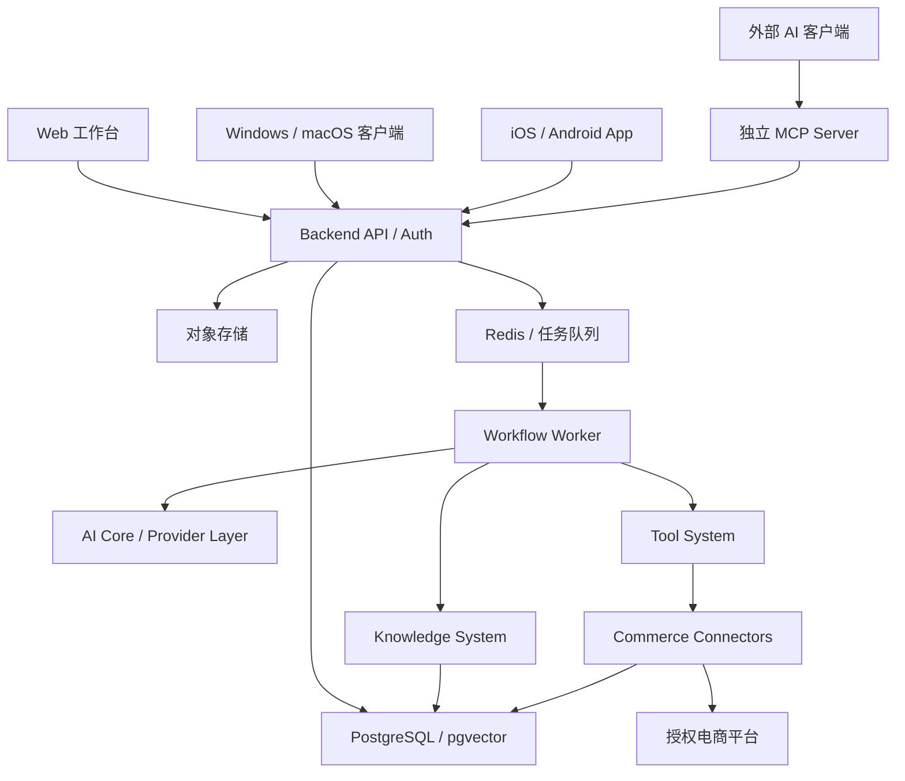

# ARCHITECTURE — 系统架构提案

状态：开发设计基线 v1.0；关联 DOMAIN_MODEL、WORKFLOW_ENGINE、PERMISSIONS、SECURITY 和 API_DESIGN。优先采用模块化单体业务 API + 独立 MCP 边界 + 可独立扩容的异步 Worker；满足规模证据后再拆服务。所有跨模块交互基于版本化契约，tenant_id 从授权上下文注入，不接受客户端自报租户。

## 模块契约

| 模块 | 职责 | 输入 | 输出 | 依赖 |
| --- | --- | --- | --- | --- |
| Frontend | Web/Windows/macOS 工作台、iOS/Android App；按端审核、溯源与状态展示 | API DTO、用户操作 | 授权命令、可访问视图 | Backend |
| Backend | 身份/组织/租户、RBAC、领域规则、审批、审计、API | 命令、平台事件、MCP 请求 | 领域状态、事件、审计条目 | PostgreSQL、Redis、Storage |
| AI Core | 提示词版本、路由、模型适配、结构化输出、成本/安全策略 | 任务、引用材料、预算 | 建议/草稿、证据、token/费用 | Provider Layer、Knowledge |
| Workflow Engine | 版本化 DAG/状态机、重试、超时、暂停/审批、补偿 | 事件、手动触发、流程定义 | 执行状态、待审批动作 | Backend、AI、Tools、Redis |
| Knowledge System | 文档解析、版本化、权限过滤、检索/引用 | 授权文档、查询 | 片段、来源版本、置信标记 | PostgreSQL/pgvector、Storage |
| MCP Server | 向外部 AI 暴露有边界工具/资源 | 已认证的 MCP 请求 | 结构化响应、审计关联 ID | Backend、Tool Registry |
| Tool System | 工具声明/版本、参数校验、授权和风险分级 | 结构化工具调用 | 执行结果/错误 | Backend、Connectors |
| Commerce Connector | 平台授权、字段映射、限流、幂等、同步和回执 | 平台凭据引用、业务命令 | 标准化商品/订单快照、发布回执 | 官方平台 API、队列 |
| Database | 交易事实、租户隔离、审计与检索索引 | 事务写入/查询 | 一致性快照、索引 | PostgreSQL；对象存储保原件 |

## 端到端业务路径

商品发布：商品草稿→字段和来源验证→平台特有映射/预检→审批记录（操作人、版本、店铺、内容摘要）→幂等发布任务→平台回执/失败原因→必要时人工恢复。发布前重新校验审批绑定的草稿版本；连接器不得绕过 API 的授权与审批。

客服：问题→权限过滤的知识/订单检索→AI 建议+引用→人工审阅→允许的发送操作→留存决策与回执。市场分析使用有许可的源数据及明确的指标口径。

## 控制与故障边界

- 身份认证接入成熟 OIDC/OAuth；组织/工作区角色 + 资源作用域校验。连接平台时最小权限、密钥托管、轮换与撤销。
- PostgreSQL 业务记录带组织作用域；服务层强制范围，数据库 RLS 作为纵深防御候选，需通过跨租户负例验证。知识向量索引与对象路径同样隔离。
- 所有写操作具备权限校验、幂等键、审计关联 ID；外部 API 限流、退避、死信队列、可人工重试。订单/库存快照含来源和同步时间，不假定实时。
- 提示注入视为不可信数据；知识片段与工具参数隔离。AI 不能提高自身权限；工作流节点仅执行注册工具。高风险动作设可配置审批门槛。
- 保留执行链的模型/提示词/知识版本、输入摘要、决策、审批、平台回执，敏感内容脱敏；留存期按租户合同和法律要求再定。
- 可观测性：请求/执行关联 ID、运行状态、失败率、延迟、成本、审计异常；明确定义同步滞后与供应商故障降级。

## 领域事务与边界

Business API 是唯一领域命令入口；内部 worker 使用同一领域服务和权限策略，MCP 不持有直接数据库权限。Catalog 保存 Product/SKU，Channel Integration 保存 Listing/Receipt，Approval 固定内容摘要；事务内 outbox，事务外平台调用；平台超时的 UNKNOWN 状态需先查远端。组织为租户边界，空间/店铺为二级范围。参考 ADR-004/005。

## 五端约束

平台范围已确认；React Web + Tauri 2 桌面 + React Native/Expo 移动为 ADR-007 提案。执行服务共用，不复制租户校验/发布流程到客户端。所有客户端支持后台任务恢复查询、在线审批和版本冲突处理；原生凭据/通知/签名验证见 [CROSS_PLATFORM_ARCHITECTURE](CROSS_PLATFORM_ARCHITECTURE.md)。

## 演进约束

首期不拆 AI Core/Workflow/Connector 成独立微服务；目录预留边界，worker 可分进程。MCP 独立部署仅承担协议适配，不复制业务权限与数据。连接器仅在获得平台官方可用性验证后启用写入；所有平台细节隔离在适配层。
